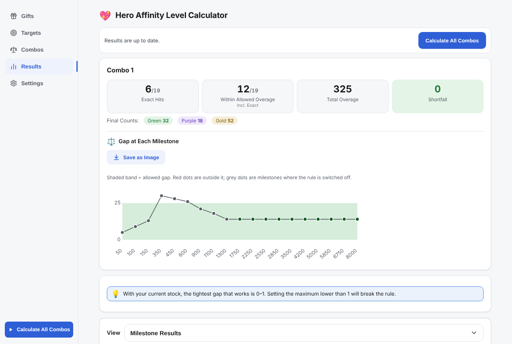

# 💖 Hero Affinity Level Calculator

**English** | [繁體中文](docs/readme/README.zh-TW.md) | [简体中文](docs/readme/README.zh-CN.md) | [日本語](docs/readme/README.ja.md) | [한국어](docs/readme/README.ko.md) | [Español](docs/readme/README.es.md) | [Français](docs/readme/README.fr.md) | [Deutsch](docs/readme/README.de.md) | [Português](docs/readme/README.pt.md) | [Tiếng Việt](docs/readme/README.vi.md) | [ไทย](docs/readme/README.th.md) | [Bahasa Indonesia](docs/readme/README.id.md) | [Русский](docs/readme/README.ru.md) | [Türkçe](docs/readme/README.tr.md) | [Italiano](docs/readme/README.it.md) | [Polski](docs/readme/README.pl.md) | [العربية](docs/readme/README.ar.md) | [Filipino](docs/readme/README.fil.md)

  

A free, single-page web calculator for **Pixel Brave Idle**. Enter the gifts you own, pick the affinity rewards you are aiming for, and it works out the smallest number of each gift needed to hit every target, while keeping the gift colours balanced the way you choose.

Runs entirely in your browser. No account, no server, nothing is uploaded.

**Use it online:** https://ghg-jam.github.io/PBI-hero-affinity-calculator/

> Unofficial fan-made tool. Not affiliated with or endorsed by the game's developer.

<p>
  
  
</p>


## Features

- **Gift counter** for the three tiers (green / purple / gold), with favorite gifts and their bonus values.
- **Reward targets**: tick one or more built-in milestone lists (grouped by name, one row per colour set), add your own custom targets, and choose your own **final goal** (the plan ends exactly there).
- **Combos**: any number of plans, each with its own gift-balance rule: which colour has more, and a gap that is kept **within a range** (with quick presets such as 0–25 or 0–200), made as **large as possible**, or made as **small as possible**.
- **Plan from current affinity**: enter where the hero is now. The tool estimates which gifts were already used and plans only the milestones still ahead.
- **Results**: exact hits, overage and shortfall per milestone, gifts needed per stage (with icons for the gifts used), a gap chart, and progress bars with a pin per goal. Results only change when you press **Calculate All Combos**, so you can adjust settings freely; a bar above the results tells you when they are out of date.
- **Advanced options** (hidden by default): where the gap limit starts, a "Max Points Over Target" limit, non-favorite gifts, a total limit per colour, per-gift limits (with a one-tap **Clear all limits**) and a custom spending order.
- **AI-assisted fill**: copy the prompt, send it with a screenshot to a **new** AI chat, then paste the JSON reply back, or import it from a file if the AI gives you one. AI can misread numbers, so always compare the result with your game.
- **Save data**: your inputs are kept in the browser automatically. You can also download a save file, load it later, or reset.
- **18 languages**: English, 繁體中文, 简体中文, 日本語, Español, Français, Deutsch, Português, Tiếng Việt, ไทย, Bahasa Indonesia, Русский, Türkçe, Italiano, Polski, العربية (right-to-left), 한국어, Filipino.
- **Responsive**: bottom tab bar on phones, side navigation on tablets and desktop. Light and dark mode follow the system setting by default; Settings also has 11 colour themes plus a custom colour, and a text and UI size option.

## Quick start

1. Open the site.
2. **Gifts**: enter how many of each gift you have. Tap the star to mark a hero's favorite (one per colour).
3. **Targets**: enter the current affinity (optional) and tick the reward lists you want.
4. **Combos**: keep the defaults, or change the gap rule (range, largest or smallest gap) and open *Advanced Settings* for which gifts to use, limits and the allowed overage.
5. **Results**: press **Calculate All Combos**, then read how many of each gift to use. With several combos there is one section per combo.

## Run locally

Two ways, both work offline:

- **One file:** download `download/combo_calculator_single.html` and double-click it.
- **Whole folder:** download the repository, keep the folders (`css`, `js`, `lang`) next to `index.html`, and double-click `index.html`.

## Deploy on GitHub Pages

1. Upload the **contents** of this folder to the repository root (drag the files and folders into the GitHub upload page, keep the folder structure). The full step-by-step guide is in [docs/UPLOAD_GUIDE.md](docs/UPLOAD_GUIDE.md).
2. In the repository, go to **Settings → Pages**, choose the main branch and the root folder.
3. After an update, hard refresh the page (Ctrl/Cmd + Shift + R). Every file link carries a version number (`?v=`), so changing that number in `index.html` makes browsers fetch the new files.

GitHub Pages is case-sensitive: keep every file name in lower case exactly as shipped.

## Changelog

See [CHANGELOG.md](CHANGELOG.md).

## Repository layout

```
index.html        the page (only markup; loads the files below)
css/              styles, loaded in this order: base, layout, tabs, icons-fixes, nav, components
js/               code, one file per area (data, solver, state, theme, one file per tab, save, image export...)
lang/             one file per language (en.js loads with the page, the others load when selected)
download/         the same app as ONE standalone html file
CHANGELOG.md      what changed in each version
README.md         this file
LICENSE           MIT license (code only)
docs/             screenshots and the upload guide
archive/          v0, v1 and v2-single (V2 before the code was split) for rollback
```

## Contributing

Bug reports and translation fixes are welcome: open an issue or a pull request. The 17 translated READMEs in [docs/readme](docs/readme) are machine-assisted; corrections from native speakers are appreciated.

## Adding or fixing a translation

Open `lang/<code>.js` (for example `lang/ja.js`). Each line is `"key": "text"`. Keep the keys, change only the text, and keep placeholders such as `{n}`, `{v}` or `{a}` untouched. Every language file must contain exactly the same keys as `lang/en.js`.

## License

[MIT](LICENSE) (code only). Game names and artwork belong to their respective owners.
