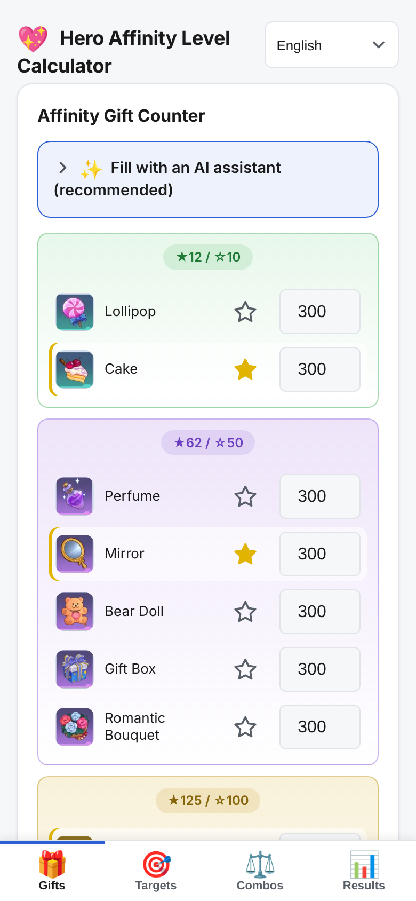

# 💖 Calculadora de Nível de Afinidade do Herói

[English](../../README.md) | [繁體中文](README.zh-TW.md) | [简体中文](README.zh-CN.md) | [日本語](README.ja.md) | [한국어](README.ko.md) | [Español](README.es.md) | [Français](README.fr.md) | [Deutsch](README.de.md) | **Português** | [Tiếng Việt](README.vi.md) | [ไทย](README.th.md) | [Bahasa Indonesia](README.id.md) | [Русский](README.ru.md) | [Türkçe](README.tr.md) | [Italiano](README.it.md) | [Polski](README.pl.md) | [العربية](README.ar.md) | [Filipino](README.fil.md)

Uma calculadora web gratuita para **Pixel Brave Idle**: informe os presentes que você tem, escolha as recompensas de afinidade que deseja e veja quantos presentes de cada tipo são necessários, no mínimo.

Funciona inteiramente no seu navegador. Sem conta, sem servidor e nada é enviado.

**Usar online:** https://ghg-jam.github.io/PBI-hero-affinity-calculator/

> Ferramenta não oficial feita por fãs. Sem afiliação ou aprovação do desenvolvedor do jogo.

  
  

## Recursos

- Contador de presentes dos três níveis (verde / roxo / dourado) com favoritos.
- Metas de recompensa: listas de marcos integradas, metas personalizadas e meta final.
- Vários combos (planos), cada um com sua própria regra de equilíbrio de presentes.
- Planejamento a partir da afinidade atual: estima os presentes já usados e calcula só os marcos restantes.
- Resultados: acertos exatos, excesso, falta, presentes por etapa, gráfico de diferença e barras de progresso.
- Preenchimento com IA a partir de uma captura de tela, salvar/carregar dados, 18 idiomas, modo claro/escuro e 11 cores de tema.

## Como usar

1. **Presentes**: informe quantos tem de cada um e marque o favorito com a estrela.
2. **Metas**: informe a afinidade atual (opcional) e marque as listas de recompensas.
3. **Combos**: mantenha o padrão ou abra *Configurações avançadas*.
4. **Resultados**: veja quantos presentes de cada tipo usar.

## Executar localmente

- Baixe `download/combo_calculator_single.html` e clique duas vezes.
- Ou baixe o repositório inteiro, mantenha as pastas `css`, `js` e `lang` ao lado de `index.html` e abra `index.html`.

## Publicar no GitHub Pages

1. Envie **todo o conteúdo** da pasta para a raiz do repositório (mantendo as pastas).
2. Em **Settings → Pages**, escolha a branch main e a pasta raiz.
3. Após atualizar, recarregue sem cache (Ctrl/Cmd + Shift + R).

## Informações para desenvolvedores

A estrutura do projeto, como contribuir com traduções e o histórico de alterações estão no [README em inglês](../../README.md).

## Licença

Licença MIT (somente o código).
