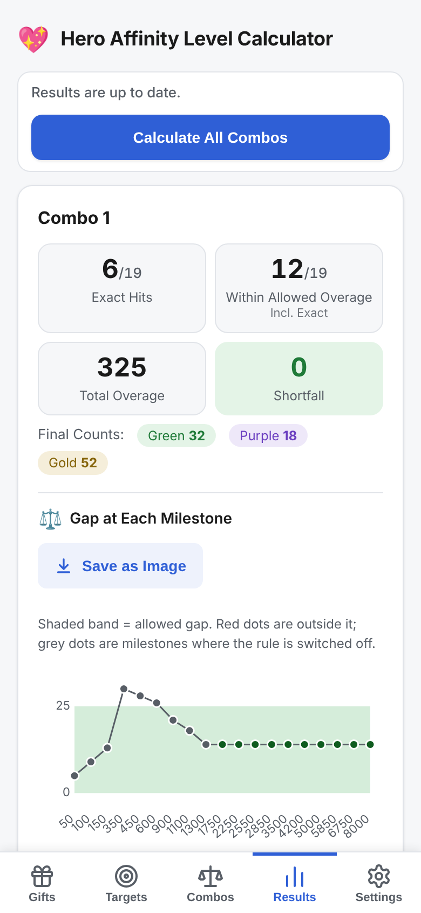

# 💖 Kahraman Yakınlık Seviyesi Hesaplayıcı

[English](../../README.md) | [繁體中文](README.zh-TW.md) | [简体中文](README.zh-CN.md) | [日本語](README.ja.md) | [한국어](README.ko.md) | [Español](README.es.md) | [Français](README.fr.md) | [Deutsch](README.de.md) | [Português](README.pt.md) | [Tiếng Việt](README.vi.md) | [ไทย](README.th.md) | [Bahasa Indonesia](README.id.md) | [Русский](README.ru.md) | **Türkçe** | [Italiano](README.it.md) | [Polski](README.pl.md) | [العربية](README.ar.md) | [Filipino](README.fil.md)

**Pixel Brave Idle** için ücretsiz web hesaplayıcı: sahip olduğun hediyeleri gir, hedeflediğin yakınlık ödüllerini seç ve her hediyeden en az kaç tane gerektiğini öğren.

Tamamen tarayıcında çalışır. Hesap yok, sunucu yok, hiçbir şey yüklenmez.

**Çevrimiçi kullan:** https://ghg-jam.github.io/PBI-hero-affinity-calculator/

> Resmî olmayan, hayranlar tarafından yapılmış bir araçtır. Oyunun geliştiricisiyle bağlantısı yoktur ve onaylanmamıştır.

  
  

## Özellikler

- Üç kademe (yeşil / mor / altın) için hediye sayacı ve favoriler.
- Ödül hedefleri: yerleşik kilometre taşı listeleri, özel hedefler ve nihai hedef.
- Birden çok kombo (plan); her birinin kendi denge kuralı var: hangi renk daha fazla ve fark **bir aralıkta** tutulur (0–25, 0–200 gibi hazır seçeneklerle), mümkün olduğunca **büyük** veya mümkün olduğunca **küçük** olur.
- Mevcut yakınlıktan planlama: harcanmış hediyeleri tahmin eder, yalnızca kalan kilometre taşlarını hesaplar.
- Sonuçlar: kilometre taşı başına tam isabet, fazlalık ve eksik, aşama başına gereken hediyeler (kullanılan hediye simgeleriyle), fark grafiği ve ilerleme çubukları. Sonuçlar yalnızca **Tüm Kombinasyonları Hesapla**’ya bastığınızda değişir; eskidiklerinde üstteki bir çubuk uyarır.
- Gelişmiş seçenekler (varsayılan olarak gizli): fark sınırının başladığı yer, “hedefin üstünde en fazla puan” sınırı, favori olmayan hediyeler, renk başına toplam sınır, hediye başına sınırlar (tek dokunuşla temizlenebilir) ve özel harcama sırası.
- Yapay zekâ ile doldurma: istemi kopyalayın, ekran görüntüsüyle **yeni** bir yapay zekâ sohbetine gönderin, JSON yanıtını yapıştırın (veya dosyadan içe aktarın). Yapay zekâ sayıları yanlış okuyabilir; her zaman oyunla karşılaştırın. Ayrıca: veri kaydet/yükle, 18 dil, açık/koyu mod ve 11 renk teması.

## Nasıl kullanılır

1. **Hediyeler**: her hediyeden kaç tane olduğunu gir, favoriyi yıldızla işaretle.
2. **Hedefler**: mevcut yakınlığı gir (isteğe bağlı) ve istediğin ödül listelerini işaretle.
3. **Kombolar**: varsayılanları koruyun veya fark kuralını (aralık, en büyük ya da en küçük) seçip *Gelişmiş Ayarlar*’ı açın.
4. **Sonuçlar**: **Tüm Kombinasyonları Hesapla**’ya basıp her hediyeden kaç tane kullanılacağını okuyun.

## Yerelde çalıştır

- `download/combo_calculator_single.html` dosyasını indir ve çift tıkla.
- Ya da tüm depoyu indir, `css`, `js` ve `lang` klasörlerini `index.html` yanında tut ve `index.html` dosyasını aç.

## GitHub Pages’te yayınla

1. Klasörün **tüm içeriğini** deponun köküne yükle (klasör yapısını koru).
2. **Settings → Pages** bölümünde main dalını ve kök klasörü seç.
3. Güncellemeden sonra sayfayı zorla yenile (Ctrl/Cmd + Shift + R).

## Geliştiriciler için

Proje yapısı, çeviri katkısı ve değişiklik günlüğü için [İngilizce README](../../README.md) dosyasına bak.

## Lisans

MIT lisansı (yalnızca kod).
